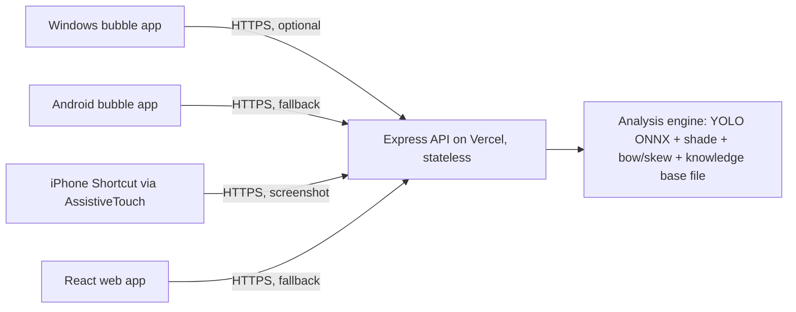

# Fabric Inspector v2: specification (draft for approval)

Status: APPROVED in principle (2026-11-13); building starts after the model passes the quality gate ·
Design: approved mockup `design/redesign_mockup_v2_fern.html`
Rule for this project: nothing is built until this spec is approved, and nothing is shared until the
device test checklist (section 9) passes on the real devices.

---

## 1. Goal

One fabric inspection tool for the thesis "Fabric defect detection with AI cause/remedy analysis".
A floating bubble (pick-glass design) lets the user check fabric shown anywhere on the screen or in a photo.
Each check gives: detected defects, severity (ASTM D5430 4-point system), likely causes, remedy and
prevention from the knowledge base, plus optional shade (ΔE CMC 2:1) and bow/skew checks.

Users: textile student/engineer, quality inspector, thesis examiners (demo).

## 2. Platforms and the bubble

| Platform | Bubble | How a check starts | Where the AI runs |
|---|---|---|---|
| Windows 10/11 | Own floating bubble (PyQt6, exists, restyled to fern) | Click bubble → select screen area, or upload | On the PC (default) or server |
| Android 8+ | Own floating bubble (native app, overlay permission) | Tap bubble → select area (screen capture permission) | On the phone, server fallback |
| iPhone (iOS 15.8+) | Apple AssistiveTouch → "Fabric Check" Shortcut | Tap AssistiveTouch → Fabric Check → screenshot sent | Server |
| Any browser | No bubble (browsers cannot draw over other apps) | Upload / camera on the web dashboard | In browser if supported, else server |

Apple and browser limits are platform rules, not choices. They are stated in the thesis as limitations.

## 3. Architecture (React + Express on Vercel, no database)

Decision (user, 2026-11-13): checks are only analysed and shown, never stored. No MongoDB.

- **Analysis engine**: one JavaScript engine (already written and verified to give identical results to
  the Python version) used in three places: browser, Android, and the Express API (Node.js with
  onnxruntime-node). One engine means the same result on every device.
- **Express API on Vercel** (serverless, stateless: nothing is saved):
  - `POST /api/analyze`: image in → full result out (used by iPhone, older phones, optional for others)
  - `GET /api/health`: model version and engine status
- **Knowledge base**: a file shipped with the app (from `knowledge_base.yaml`). Changes = edit file + republish.
- **React web app on Vercel**: upload/camera, result view, download report (TXT/PDF) to the user's own device.
- **To verify first (technical spike, before building anything else)**: the analysis runs inside Vercel's
  free-tier function limits (size, memory, time). If it does not, the fallback is a free server-side
  alternative, decided with you before continuing.

## 4. Analysis and verdict rules

- Model: the best of R1v2 / R4v2 (decided by results), later fine-tuned on own photos.
- **Quality gate before any build is shared** (to agree with you):
  - test-set mAP@0.5 ≥ 0.60 (R1 was 0.47, 0.53 on the cleaned test set)
  - on 30 own fabric photos: at least 70% of visible defects found, at most 1 false alarm per 5 photos
- Confidence threshold: chosen from the F1 curve of the final model (R1: 0.23).
- **Verdict (exactly three states)**:
  1. Defects found → highest severity chip + "N defects · P points".
  2. Nothing found → "No defects detected. The AI can miss defects, so check the fabric visually." Never "acceptable".
  3. Cannot analyse → reason + fix, e.g. "Photo too dark. Retake it in even daylight, straight from above."
     (checks: brightness, blur, image too small)
- Severity: ASTM D5430 points (needs image scale: ruler or a typed px/mm; otherwise relative-size fallback,
  clearly labelled). Shade: ΔE CMC(2:1) vs tolerance. Bow/skew: % vs buyer limits (2 % / 3 % default).
- Shade and bow/skew only when the user switches them on, with the photo-condition warning.

## 5. Data

Nothing is stored. The server analyses the image in memory and forgets it after answering.
The user can download a report (TXT/PDF with the annotated image) to their own device.
If history is ever wanted later, a database can be added without changing the analysis engine.

## 6. Screens (see mockup)

- Windows: bubble · area selector · compact result panel (verdict, annotated image, defect list with
  expandable causes/remedy/prevention, shade/skew tiles) · settings.
- Android: bubble · area selector with corner handles · result bottom sheet · first-run permission screens.
- iPhone: one-time setup page (Shortcut link + AssistiveTouch steps with screenshots) · result sheet.
- Web app: Upload/Camera · result view (same components as the bubbles) · download report · about/help.
  (The "Web dashboard" history screen in the mockup is dropped: no storage.)
- Style: white theme, Fern green (#63b96c fills, #2f7d3b buttons/text), Archivo / IBM Plex fonts,
  pick-glass bubble, severity colours separate from the brand green.

## 7. Non-functional targets

| Item | Target |
|---|---|
| Result time | ≤ 2 s on PC, ≤ 4 s on iPhone (server), ≤ 5 s on Android |
| Same result everywhere | identical detections for the same image on all platforms (automated parity test) |
| Errors | every error shows what happened and what to do; no raw technical messages |
| Privacy | photos analysed on device where possible; the server stores nothing |
| Cost | $0: free tiers of Vercel and GitHub; APK shared directly; no Apple fees |

## 8. Build order (each step ends with its tests passing)

1. Model: finish R1v2 → R4v2 → choose → (fine-tune on own photos) → pass the quality gate.
2. Spike: analysis engine inside a Vercel function (proves the server path works).
3. Express API (analyze, health).
4. iPhone Shortcut + AssistiveTouch (test on your iPhone 15.8).
5. Windows bubble restyle (fern theme, new verdict rules, optional server mode).
6. React web app.
7. Android bubble app (APK).
8. Full device test checklist → share.

## 9. Device test checklist (must pass before sharing)

Regression tests for the problems found in v1:

| # | Test | Device | Pass condition |
|---|---|---|---|
| R1 | Open link, reload 3×, close and reopen | iPhone Safari 15.8, PC Chrome/Brave | always loads, no ERR_FAILED |
| R2 | Take photo with camera | iPhone 15.8 | photo appears and is analysed, no "no available backend" |
| R3 | Photo with obvious hole + stain + slub (your test image) | all | defects found; never "acceptable" |
| R4 | Bubble present | Windows, Android, iPhone (AssistiveTouch) | bubble visible and opens a check |

Functional tests:

| # | Test | Pass condition |
|---|---|---|
| F1 | Select screen area on Windows | captured area matches selection, result < 2 s |
| F2 | Android bubble over WhatsApp/gallery | overlay + capture permission flow works; result sheet opens |
| F3 | iPhone AssistiveTouch → Fabric Check | result sheet in ≤ 4 s |
| F4 | Photo without defects | "No defects detected" + visual-check reminder |
| F5 | Dark / blurred photo | "Cannot analyse" with the fix |
| F6 | Ruler photo with px/mm set | 4-point points match manual measurement ± 1 point |
| F7 | Shade check on two dye lots (flat, daylight) | ΔE shown; agrees with visual judgement / spectrophotometer if available |
| F8 | Download report | TXT/PDF with annotated image saves on PC, Android and iPhone |
| F9 | Same image on all platforms | same defects and points |

## 10. Accounts you will need (free, created later)

GitHub (code) · Vercel (hosting, sign in with GitHub).
Already have: Hugging Face (current v1 web app; can be retired after v2).

## 11. Decisions (answered 2026-11-13)

- No database, no logins, no history.
- Android test phone: available (user's own).
- Languages: **English and Bangla** (see section 12).
- Quality gate in section 4: accepted.

## 12. Languages (English + Bangla)

- Language switch (EN / বাংলা) on every platform; the choice is remembered on that device.
  First start follows the device language (Bangla if the phone/PC is set to Bangla).
- Everything is translated: buttons, verdicts, error messages, setup steps, and the whole knowledge base
  (defect names, causes, remedy, prevention).
- Knowledge base becomes bilingual: each text has `en` and `bn`. Claude drafts the Bangla; **you review
  the textile terms** (e.g. which Bangla words mills actually use for slub, broken pick, bowing).
  Standard names stay in Latin script where that is normal (ASTM D5430, ΔE CMC, mm, %).
- Bangla font: Noto Sans Bengali (web, Android); Windows uses Nirmala UI (built in).
- Numbers stay in Western digits (0–9) in both languages, so measurements read the same everywhere.
- Report download in the language currently selected.

Extra tests:

| # | Test | Pass condition |
|---|---|---|
| L1 | Switch EN ↔ বাংলা | all visible text changes, no English left in Bangla mode (except standard names) |
| L2 | Bangla rendering | conjuncts display correctly on iPhone 15.8, Android, Windows (no boxes) |
| L3 | Bangla report | downloaded report is readable Bangla on all three devices |
